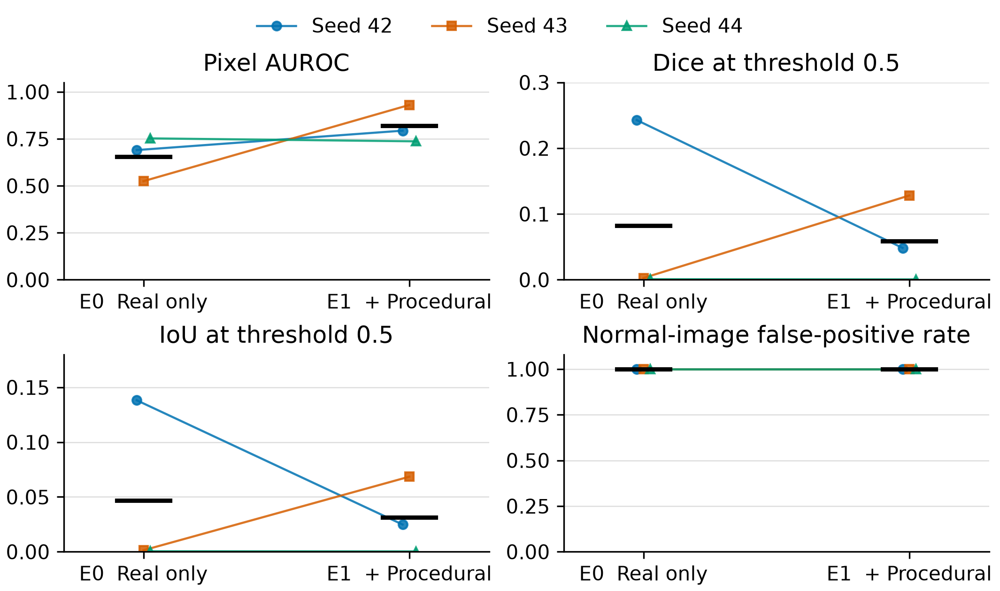

# Paired metal_nut E0 and E1 analysis

Three downstream seeds use one frozen support split and one unchanged accepted
75-pair Procedural pool. Each run has 235 real training images, 1,500 updates,
batch size eight, and the same 77-image real evaluation partition. Model settings
and recorded package versions match. E0 results were reused, not retrained.

## Per-seed results

| Seed | E0 AUROC | E1 AUROC | Delta AUROC | E0 Dice | E1 Dice | Delta Dice |
|---|---:|---:|---:|---:|---:|---:|
| 42 | 0.6903 | 0.7936 | +0.1033 | 0.2428 | 0.0484 | -0.1943 |
| 43 | 0.5248 | 0.9303 | +0.4055 | 0.0027 | 0.1282 | +0.1255 |
| 44 | 0.7525 | 0.7368 | -0.0157 | 0.0009 | 0.0006 | -0.0003 |

## Across-seed comparison

Means and sample SDs describe downstream randomness only. Paired differences
subtract E0 from E1 at the same seed; their SD is not obtained by subtracting the
two marginal SDs.

| Metric | E0 mean ± SD | E1 mean ± SD | Paired change mean ± SD |
|---|---:|---:|---:|
| Pixel AUROC | 0.6559 ± 0.1177 | 0.8202 ± 0.0995 | 0.1644 ± 0.2171 |
| Dice | 0.0821 ± 0.1391 | 0.0591 ± 0.0644 | -0.0231 ± 0.1611 |
| IoU | 0.0467 ± 0.0792 | 0.0312 ± 0.0345 | -0.0155 ± 0.0912 |
| Anomalous-image recall | 1.0000 ± 0.0000 | 1.0000 ± 0.0000 | 0.0000 ± 0.0000 |
| Normal-image FPR | 1.0000 ± 0.0000 | 1.0000 ± 0.0000 | 0.0000 ± 0.0000 |

Connected points pair the same downstream seed. Black horizontal marks indicate
condition means. At FPR = 1.0, points are offset slightly along the horizontal
axis so all three seeds remain visible. Each panel has its own labelled metric
scale; no significance test or confidence interval is implied.

## Interpretation

The average AUROC gain is 0.1644, with paired sample SD 0.2171. Inspect the
individual seeds as well as their mean. AUROC measures pixel ranking over all
thresholds; it does not guarantee useful predictions at the frozen threshold 0.5.
Mean Dice and IoU decrease, while normal-image FPR stays at 1.0: all 22 normal
test images trigger at least one predicted-positive pixel for every seed in both
conditions. Recall of 1.0 consequently does not demonstrate useful image-level
inspection. The experiment supports a descriptive ranking gain for this category,
not an overall improvement in segmentation or detection.

The synthetic pool has generic synthetic_patch labels. These results do not
establish named-defect realism, results for screw, generator-seed robustness, or
superiority over GAN/Diffusion. Screw remains on hold; missing methods are not
assigned zero and no two-category Procedural macro score is calculated.

## Reproduction and records

Run `python scripts/reporting/plot_e0_e1_metal_nut.py` from the repository root.
The script reads the six committed result files and writes the figure and
[source hashes with paired plot values](e0_e1_metal_nut_plot_data.json).
[Full-precision summary](../../results/metrics/e1_metal_nut_20261017/summary.json)
and [execution record](../../results/metrics/e1_metal_nut_20261017/execution_record.json)
retain the frozen protocol, provenance and result-file hashes. The primary
training protocol and thresholds remain unchanged after this analysis.
