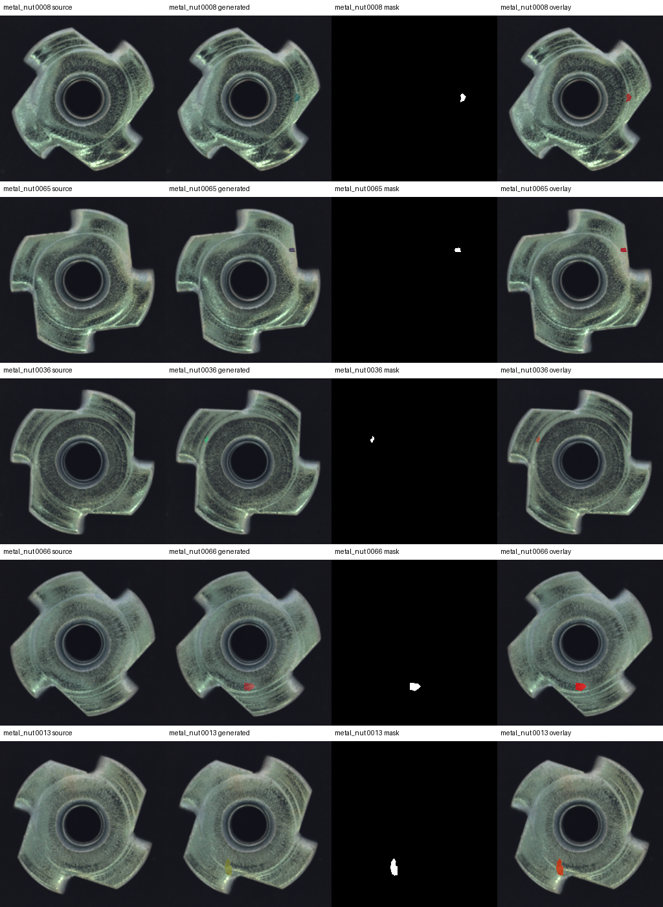
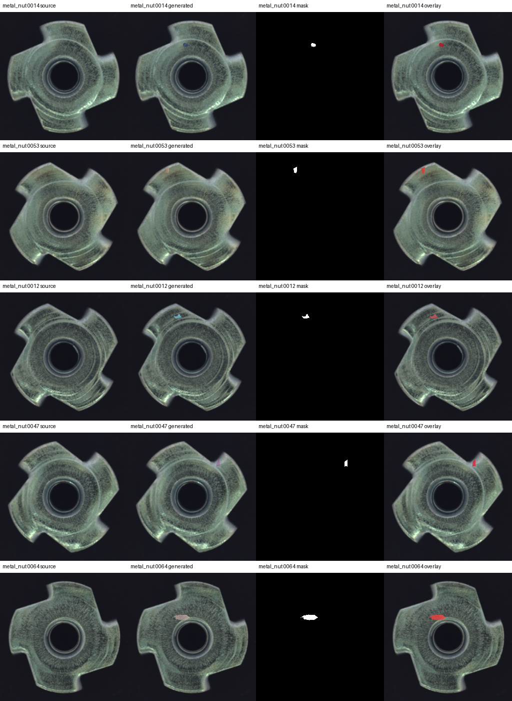
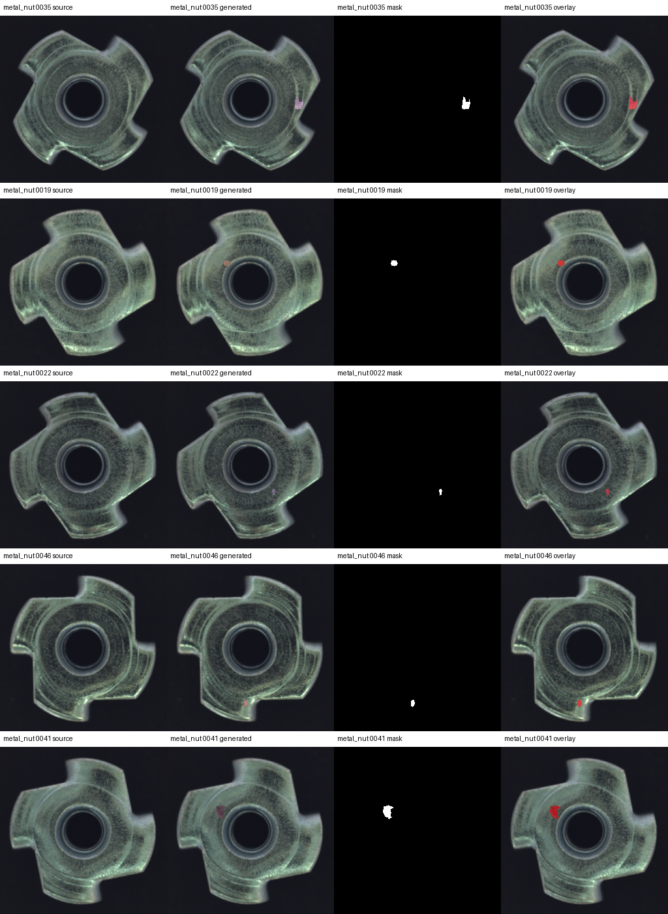
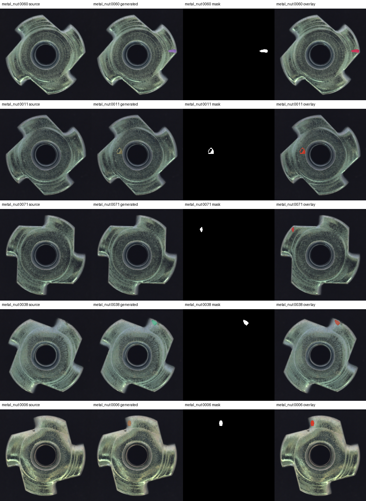
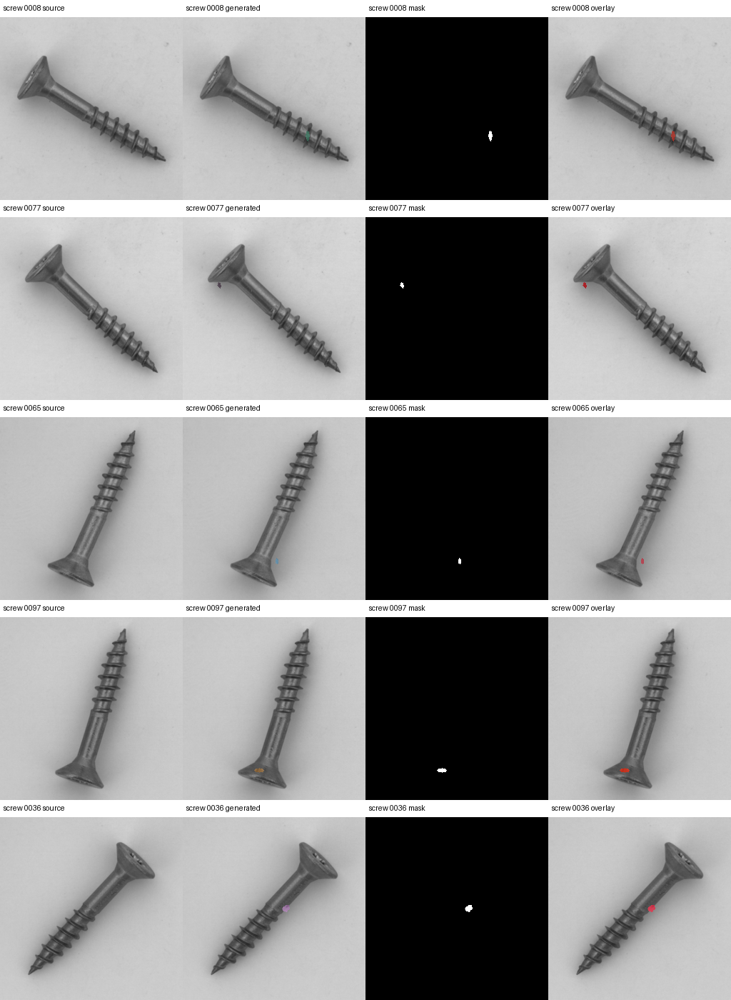
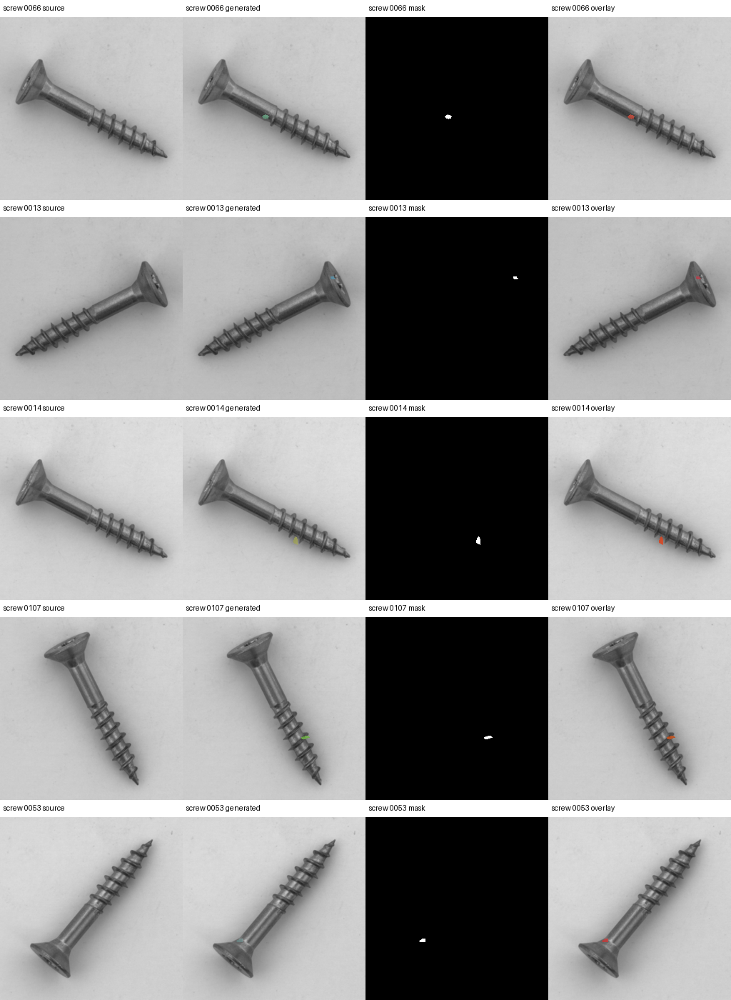
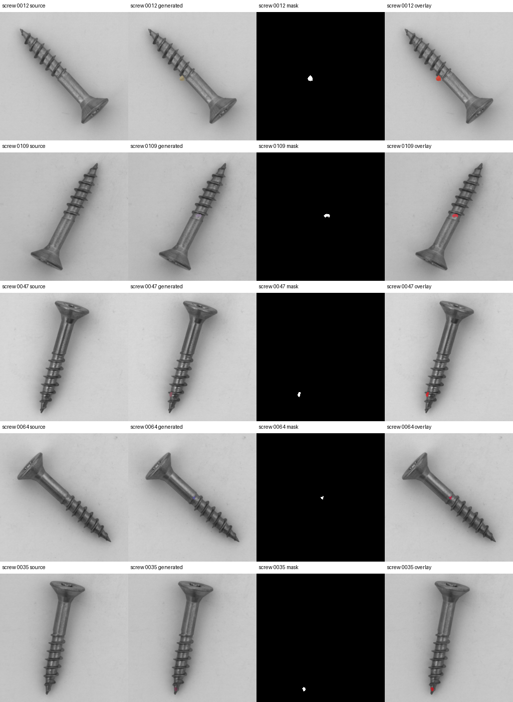
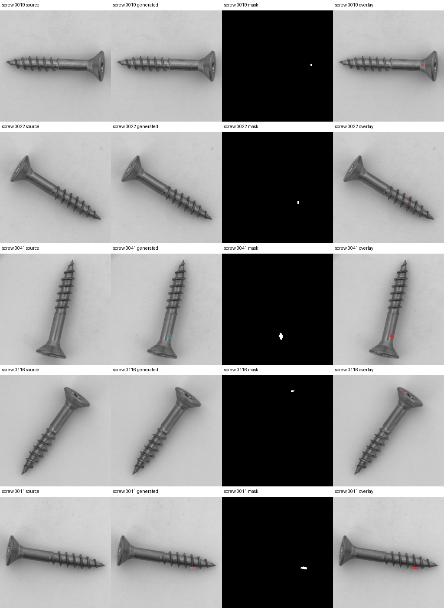

# B delivery review sheets and verification results

17 October 2026 — Procedural candidate pools. The full delivery package has been
received and independently rechecked under A's TC2 account. This page contains
fixed review sheets; the complete training pools, dataset archive and weights
remain in external project storage.

| Category | Delivered pairs | Generation attempts | A's shared-QC recheck | Review outcome |
|---|---:|---:|---:|---|
| metal_nut | 75 | 83 | 75/75 | Technical review complete; recommended for acceptance; formal record not yet issued |
| screw | 125 | 136 | 125/125 | Technical review complete; batch on hold for placement problems |

The archive SHA-256 matches the delivery record, and all 500 package-file checksums
pass. The frozen manifest, original-data hashes, and source/donor membership have
been verified. For all 200 pairs, masks match the pixels changed in the canonical
float32 images, and PNG exports match the canonical data. Hashes of the three
generation source files match the delivery provenance.

## How to read the sheets

Each sheet has five rows. From left to right, each row shows the **normal source
image, generated image, mask, and mask overlay**. Source images come from the
frozen manifest's train/good partition; no held-out images are displayed.

The 20 pairs per category follow A's existing audit script: seed 42, shuffle, then
successive pop operations. No samples were removed or replaced. B's supplementary
review set uses a different sampling procedure and is recorded separately.

The generated label is generic `synthetic_patch`; it does not establish named
defect semantics such as bent or scratch. Passing automated QC and pixel-alignment
checks does not establish realistic defect quality or downstream benefit.

## Findings and acceptance status

- **metal_nut:** No clear systematic placement onto the background was observed
  in A's fixed 20 pairs. Some patches are small, low contrast, or close to an
  object edge. The current recommendation is to accept this category's batch.
- **screw:** B's supplementary samples 0009 and 0082 show shadow/background
  patches. A's samples 0077 and 0065 also raise edge/shadow concerns. The entire
  batch remains on hold. Do not remove individual samples, refill the pool, or
  relax shared QC. Samples 0009 and 0082 are not in A's fixed set below.
- **Review completed:** Package integrity, provenance checks, mask alignment,
  shared-QC rechecks, and Codex-assisted visual review have been completed.
- **Record still outstanding:** No formal-purpose review or batch-acceptance
  record has been issued, and E1 training has not started. The visual review was
  assisted by Codex and must not be represented as an additional independent
  human review. These outstanding records do not mean that the completed
  technical checks need to be repeated. Legacy B provenance is handled under
  the [A execution runbook](../../formal_evaluation_runbook.md#用途校验与历史-b-bundle).

## Metal nut

### Sheet 1

Sample IDs: 0008, 0065, 0036, 0066, 0013.

### Sheet 2

Sample IDs: 0014, 0053, 0012, 0047, 0064.

### Sheet 3

Sample IDs: 0035, 0019, 0022, 0046, 0041.

### Sheet 4

Sample IDs: 0060, 0011, 0071, 0038, 0006.

## Screw

### Sheet 1

Sample IDs: 0008, 0077, 0065, 0097, 0036.

### Sheet 2

Sample IDs: 0066, 0013, 0014, 0107, 0053.

### Sheet 3

Sample IDs: 0012, 0109, 0047, 0064, 0035.

### Sheet 4

Sample IDs: 0019, 0022, 0041, 0116, 0011.

## Sources and verification records

- [Machine-readable summary and image hashes](review_manifest.json)
- [Image attribution and license](ATTRIBUTION.md)
- [B code-delivery record](../../member_b_delivery.md)
- [Formal evaluation protocol](../../formal_evaluation_protocol.md)

Generation code: `bf798af`. Independent verification code: `fd12294`.
The full batches and original logs remain in external project storage. These
eight review sheets do not replace the full delivery or formal acceptance record.
